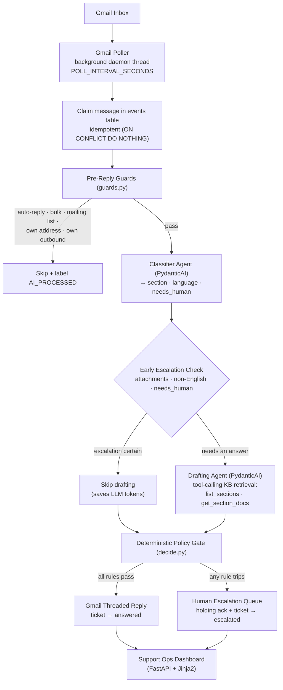

# Harbor & Pine — Automated AI Customer Support System

An end-to-end AI support agent for a fictional outdoor-gear retailer (**Harbor & Pine**): it polls a Gmail inbox, triages every customer thread with LLM agents, drafts replies grounded in a PostgreSQL knowledge base, and — critically — **never sends an email a deterministic policy gate doesn't approve**. Everything it does is visible in a server-rendered Support Ops dashboard, and the whole decision pipeline is covered by an automated PydanticEvals suite.

## Key Features

- **End-to-end Gmail triage** — a resilient background poller claims unprocessed inbox messages, applies pre-reply guards (auto-responders, bulk mail, mailing lists, self-messages), and labels everything it touches `AI_PROCESSED` so nothing is ever handled twice.
- **Tool-calling knowledge-base retrieval** — a PydanticAI drafting agent answers customers using two tools backed by Postgres (`list_sections`, `get_section_docs`), so replies are grounded in curated policy docs rather than the model's imagination.
- **Deterministic policy escalation gate** — a pure-Python `decide.py` step has final say on every send. Five escalation rules route attachments, non-English mail, sensitive topics, and unanswerable questions to a human — the LLM never gets to override policy.
- **Token-aware early escalation** — when escalation is already certain (attachments, non-English, `needs_human`), the drafting call is skipped entirely.
- **Automated PydanticEvals suite** — 12 golden email cases (7 reply, 5 escalation) run through the *same* `evaluate_thread` code path as production, graded by 4 evaluators (action, skip logic, reply grounding, section routing).
- **Server-rendered Support Ops dashboard** — FastAPI + Jinja2 UI with a ticket queue (status filters + summary counts), per-ticket transcripts, human reply/resolve actions, and full knowledge-base CRUD.

## Architecture & Decision Pipeline



**How a message flows** (`app/pipeline.py:handle_message`):

1. **Claim** — the message ID is inserted into the `events` table with `ON CONFLICT DO NOTHING`, making processing idempotent and crash-safe (an unfinished event is retried on the next poll).
2. **Pre-reply guards** (`app/guards.py`) — skip reasons: `sent_by_us`, `from_self`, `auto_submitted`, `bulk_precedence`, `mailing_list`. Skipped messages are labelled `AI_PROCESSED` and never re-polled.
3. **Classifier agent** (`app/classifier.py`) — a PydanticAI agent returns a structured `Classification` (KB `section`, ISO 639-1 `language`, `needs_human`). The section is validated against the live KB whitelist, so a hallucinated section can never reach the database.
4. **Early escalation check** — if the latest message has attachments, is non-English, or the classifier set `needs_human`, drafting is skipped and the pipeline goes straight to the policy gate.
5. **Drafting agent** (`app/agent.py`) — a tool-calling PydanticAI agent retrieves KB content via `list_sections` / `get_section_docs` and returns a structured `DraftReply` (`reply`, `enough_info`, `promises_action`).
6. **Deterministic policy gate** (`app/decide.py`) — pure Python, no LLM. First matching rule wins; every escalation sends the customer a holding acknowledgement and flags the ticket for a human.
7. **Action** — approved replies are sent on the original Gmail thread (labelled `AI_PROCESSED`); escalations land in the dashboard queue with a recorded reason. Every failure is caught per-message and recorded in `events` — a malformed email can never crash the poller.

### Deterministic Escalation Rules

Checked in `app/decide.py` in strict precedence order (rules 1–3 are also checked *before* drafting to avoid wasting tokens):

| # | Rule | Trigger | Determined by | Escalates… |
|---|----------------------|--------------------------------------------------------------------------|------------------------|------------|
| 1 | `attachments_present` | Latest inbound message carries attachments a bot cannot inspect | Thread metadata | Pre-draft |
| 2 | `non_english` | Primary language code ≠ `en` (only curated English replies are sent) | Classifier | Pre-draft |
| 3 | `needs_human` | Abuse, legal threats, security breaches, high-stakes refund disputes | Classifier | Pre-draft |
| 4 | `not_enough_info` | KB docs lack the facts to answer (agent must never guess) | Drafting agent flag | Post-draft |
| 5 | `promises_an_action` | Refund/replacement/exchange/callback requested or promised | Drafting agent flag | Post-draft |

Two defensive fallbacks (`draft_skipped`, `empty_draft`) guarantee no empty or unapproved reply is ever sent. Every escalation replies with a fixed, human-sounding holding acknowledgement and surfaces the reason on the dashboard.

## Tech Stack

| Layer | Technology |
|--------------------|------------------------------------------------------------------|
| Language | Python 3.13+, managed with [uv](https://docs.astral.sh/uv/) |
| LLM framework | PydanticAI (structured agents + tool calling) via OpenRouter |
| Evaluation | PydanticEvals (datasets, evaluators, reports) |
| Web framework | FastAPI + Jinja2 templates, served by Uvicorn |
| Database | PostgreSQL 16 (Docker Compose), psycopg 3 |
| Email | Gmail API (`gmail.modify` scope), google-api-python-client + OAuth |
| Configuration | pydantic-settings (`.env`-driven) |

## Project Structure

```
ai-customer-support/
├── app/
│   ├── main.py            # FastAPI dashboard, routes, poller lifespan thread
│   ├── pipeline.py        # Per-message pipeline + shared evaluate_thread()
│   ├── poller.py          # Forever-running Gmail poll loop (resilient)
│   ├── guards.py          # Pre-reply skip guards
│   ├── classifier.py      # Triage classifier agent (section/language/needs_human)
│   ├── agent.py           # Drafting agent with KB tool calling
│   ├── decide.py          # Deterministic policy gate (send vs. escalate)
│   ├── schemas.py         # Shared Pydantic models (ThreadMessage, Classification, …)
│   ├── gmail.py           # Gmail API wrapper (parse, label, threaded send)
│   ├── db.py              # psycopg data-access layer (events/tickets/messages/KB)
│   ├── config.py          # pydantic-settings configuration
│   ├── ai/                # (reserved package)
│   └── templates/         # Jinja2: base, tickets, ticket_detail, kb
├── evals/
│   ├── golden_emails.py   # 12 golden cases (7 reply + 5 escalation)
│   └── run_evals.py       # PydanticEvals runner + 4 evaluators
├── scripts/
│   ├── init_db.py         # Create tables + seed the Harbor & Pine KB
│   └── get_refresh_token.py  # Gmail OAuth consent → .env credentials
├── docker-compose.yml     # Postgres 16 on localhost:5433
├── pyproject.toml
└── .env.example
```

## Quickstart

**Prerequisites:** Python 3.13+, [uv](https://docs.astral.sh/uv/), Docker, and an [OpenRouter](https://openrouter.ai/) API key.

### 1. Start Postgres and install dependencies

```bash
docker compose up -d        # Postgres 16 → localhost:5433 (support_user/support_pass/support_db)
uv sync                     # installs runtime + dev dependencies
```

### 2. Configure `.env`

```bash
cp .env.example .env
```

| Variable | Purpose |
|--------------------------|--------------------------------------------------------------|
| `OPENROUTER_API_KEY` | API key for the LLM (required) |
| `CLASSIFIER_MODEL` / `AGENT_MODEL` | Model IDs, e.g. `openrouter:openrouter/free` |
| `DATABASE_URL` | Defaults to the Docker Compose Postgres |
| `GOOGLE_CLIENT_ID` / `GOOGLE_CLIENT_SECRET` / `GOOGLE_REFRESH_TOKEN` | Gmail OAuth credentials (step 3) |
| `SUPPORT_EMAIL` | The support inbox address being served |
| `POLL_INTERVAL_SECONDS` | Seconds between Gmail polls (default `30`) |
| `DASHBOARD_PASSWORD` | Dashboard access setting |

### 3. Set up Gmail OAuth

In [Google Cloud Console](https://console.cloud.google.com/): create a project, enable the **Gmail API**, configure an OAuth consent screen, and create an **OAuth Client ID** (Desktop app). Download the client secret as `credentials.json` in the project root, then:

```bash
uv run python scripts/get_refresh_token.py
```

Complete the consent flow in the browser; the script prints `GOOGLE_CLIENT_ID`, `GOOGLE_CLIENT_SECRET`, and `GOOGLE_REFRESH_TOKEN` to paste into `.env`, and set `SUPPORT_EMAIL` to that inbox's address.

### 4. Initialize the database

```bash
uv run python scripts/init_db.py
```

Creates the `events`, `tickets`, `messages`, and `knowledge_base` tables (all Gmail IDs are `UNIQUE` for idempotency) and seeds 8 Harbor & Pine KB documents across `products`, `shipping`, `returns`, and `warranty`.

### 5. Run the system

```bash
uv run uvicorn app.main:app --reload
```

This starts the dashboard at **http://127.0.0.1:8000** and launches the Gmail poller as a background daemon thread for the lifetime of the process. Emails that arrive in the support inbox are classified, drafted, and either answered on-thread or escalated — all visible in the dashboard (`/health` is available for checks).

## Evaluation Suite (PydanticEvals)

The 12 golden cases in `evals/golden_emails.py` exercise the **exact production code path** (`pipeline.evaluate_thread`) — classifier, early-escalation skip, tool-calling drafting agent, and policy gate — against a seeded KB.

**Requirements:** Postgres running with the KB seeded (step 4) and `OPENROUTER_API_KEY` set.

```bash
# Run all 12 golden cases
uv run python -m evals.run_evals

# Run a single case by (substring of) name
uv run python -m evals.run_evals --case shipping_standard_express
```

The runner prints a PydanticEvals report, a per-case PASS/FAIL breakdown per evaluator, and an overall score; the process exits non-zero if any case fails. Cases run sequentially (`max_concurrency=1`) for stable results.

**The 12 cases:** 7 reply cases (daypack capacity/cleaning, paddle board weight/PSI, tent specs, shipping thresholds, 30-day returns, warranty coverage, and a multi-turn paddle board follow-up) and 5 escalation cases, one per policy rule (attachments, French email, legal threat, out-of-scope product question, urgent replacement demand).

### The 4 Evaluators

| Evaluator | What it checks |
|--------------------|-----------------------------------------------------------------------------------|
| `ActionMatch` | `decision.action` matches the expected `reply`/`escalate`, plus the exact `escalation_reason` when one is expected. |
| `SkipLogicMatch` | Early-escalation cases (attachments, non-English, `needs_human`) must **skip** the drafting call; cases detectable only from the draft (`not_enough_info`, `promises_an_action`) must **run** it. |
| `ReplyGrounded` | For reply cases, every `expected_facts` substring (e.g. `"275 lbs"`, `"$8.95"`, `"spot-clean"`) appears in the sent reply, case-insensitively. |
| `SectionMatch` | `classification.section` routes to the expected KB section (e.g. `shipping`, `warranty`). |
